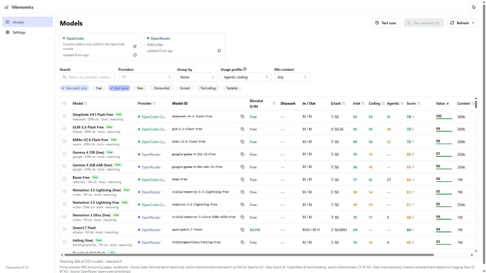
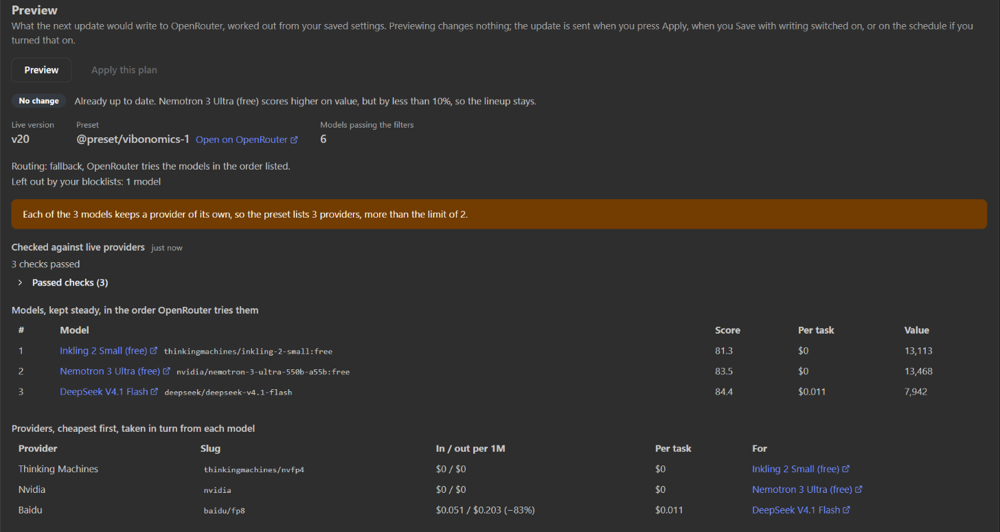
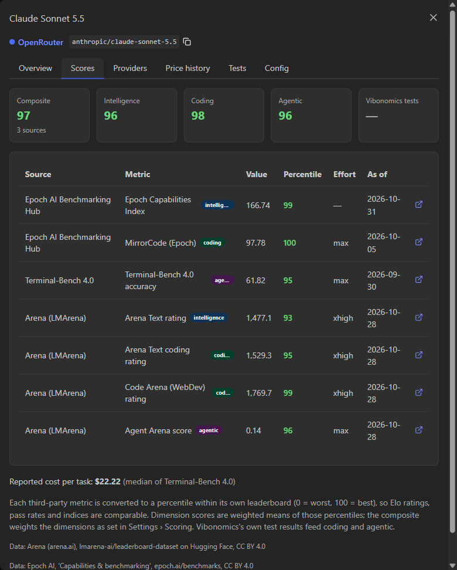
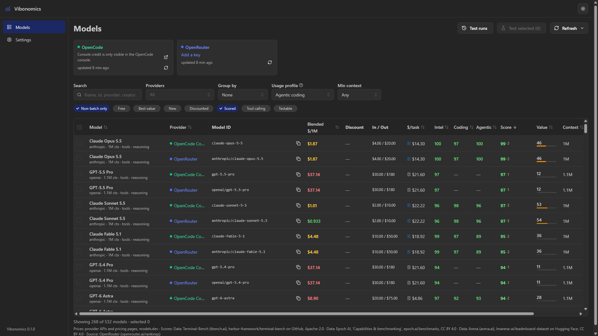

# Vibonomics

A self-hosted dashboard of LLM prices, published benchmark scores and provider balances. It works out
what a model costs for what it does, and can keep your OpenRouter presets pointed at whichever models
give the most score per dollar today.

Every pricing page says its model is the best deal. Every leaderboard says someone else's model is the
best model. Vibonomics puts both on one screen and does the division. For models nobody has scored yet,
it runs its own sandboxed tests.



*Best value first, on a fresh install with no API keys. Screenshots taken 2026-10-31; prices and scores
move.*

It reads from providers and leaderboards and does not sit in front of your inference traffic. Everything
lives in one SQLite file, and nothing is sent anywhere except the requests you enable. Two containers:
the app, and a sandbox sidecar that runs model-written code with no secrets and no network.

**Status: 0.1.0, pre-1.0.** The UI and most of the API are settled; the database schema and a few
response shapes may change between releases. One maintainer. Run on Windows (development) and Linux
(Docker). macOS is untested, as in, nobody has tried that.

## Best-value presets on OpenRouter

An OpenRouter preset is a named config that any client calls as `model: "@preset/<slug>"`. Vibonomics can
own a set of them and rewrite each one on a schedule, so every tool pointed at `@preset/vibonomics-coding`
follows the best value of the day without being reconfigured.

For each preset it:

- **Ranks** OpenRouter's models by score per dollar for a usage profile you choose, after your filters:
  minimum score, tool calling, context size, a cost-per-task ceiling, a value floor, and model and provider
  blocklists (`openai/*`, `*:free`, `deepinfra`).
- **Writes** the best 1 to 3 models (lead plus fallbacks) and their cheapest providers, up to 10,
  to `provider.only` and `provider.order`. A model already in the preset keeps its place unless another
  beats it by a set margin, so the preset doesn't flap between near ties.
- **Holds guardrails** you set: temperature, token cap, penalties, top P, quantizations, ignored providers,
  `require_parameters` and the system prompt. Each is left alone, set, or removed. Providers that don't
  support a parameter you set are left out, or the plan warns.
- **Checks before writing.** Every write is previewed against OpenRouter's live endpoint listing. A
  provider that has gone is an error and nothing is sent; low uptime, a price that moved more than 20%,
  or a model about to expire is a warning.
- **Leaves the rest alone.** Tools, reasoning settings and anything else in the preset are read back and
  sent as found. After a write it reads the preset again and names any key OpenRouter didn't keep.

Up to 20 presets, each with its own filters and schedule (every 30 minutes or slower). It touches only
presets named `vibonomics-*` or ones you adopt by hand, after an **Inspect** of their live config; an
adopted preset that someone edits on OpenRouter stops being updated until you review it again. **Preview**
shows the exact request before anything is sent. Free models are opt-in, with a paid model as the last
fallback so a spent daily free-model cap doesn't take the preset down.



*A Preview that decides to leave the preset alone, which is most of them. Taken 2026-11-14.*

Off by default. Writing needs an OpenRouter **management key**: since 2026-11-07 the preset API refuses an
ordinary key, and says so in a 401 that calls it an invalid management key, because of course it does.
Turn it on under **Settings → Providers → OpenRouter**.

The full behaviour, including adoption, the live check and the management key, is in
[docs/openrouter-presets.md](docs/openrouter-presets.md).

## What else it does

| Feature | What you get |
|---|---|
| Prices | Input, output and cache prices per 1M tokens from provider APIs or official pricing pages, falling back to models.dev. A failed refresh is recorded, not hidden behind stale numbers. |
| Discounts | OpenRouter per-provider discounts and `:free` models, Requesty's discount field, and strike-through prices on the OpenAI, Anthropic, Google, xAI, Mistral and OpenCode pages. Price history marks a model as new, discounted or newly cheaper. |
| Balances | Credit, prepaid balance or spend wherever a provider exposes one, Claude and OpenCode Go plan windows, and "not exposed by the API" with a console link where it doesn't. |
| Scores | Terminal-Bench 4.0, Arena and Epoch AI by default; OpenRouter datasets, LiveBench and Artificial Analysis opt-in. Each number keeps its source, licence and date. |
| Cost and value | A blended $/1M and an estimated $/task for a workload profile, and a value index of score per dollar. |
| Models table | Search, quick filters, grouping by provider, creator, price band or value tier, and copy-ready model IDs. |
| Your own tests | Agentic coding, tool-use, instruction-following and accuracy tasks against any models you pick, graded by unit tests in the sandbox and a judge model. |
| Config snippets | Copyable setup for VS Code (Copilot, Continue, Cline, Roo, Kilo), OpenCode, Claude Code, Codex CLI, Aider, Zed, Crush, Goose, curl and Python, with OpenRouter routing (`:floor`, `:nitro` or a pinned provider). Keys stay in environment variables. |
| Spend history | An OpenRouter account's spend and tokens by day, model, provider and API key, kept past OpenRouter's 30-day window. Needs a management key. |
| Value API | `POST /api/models/value` gives a program the same figures, so it can pick between the models it can use. |

Every number keeps its source. A model's **Scores** tab lists each leaderboard behind the composite, with
the raw value, percentile, effort setting and date:



## Quick start

Requirements: Docker with Compose v2.24 or later, and about 1 GB of RAM free (more for a rebuild).

```sh
git clone https://github.com/wulfftech/vibonomics.git
cd vibonomics
cp .env.example .env     # optional; the defaults work as they are
docker compose up -d --build
```

Open `http://localhost:2289`. No account, no sign-up, no telemetry. Tagged images are published to
`ghcr.io/wulfftech/vibonomics`, but compose from a checkout is the supported way to run it, because the
sandbox sidecar is part of the stack.

OpenRouter and the OpenCode Console show models without a key. Add keys under **Settings → Providers**,
press **Test** (it tests what you typed, before saving), then **Save**. The form links to where each key is
issued.

`./config` (mounted at `/config`) holds the database, price history, `secret.key` and the HTTP cache. Back
it up: it holds your encrypted keys, and the key file sits next to the database unless you set
`VIBONOMICS_SECRET_KEY` from your own secret store.

## Providers

A key is optional for browsing. It adds the live model list, whatever balance the provider exposes, and
the ability to run tests.

| Type | Live prices without a key | Balance |
|---|---|---|
| OpenRouter | yes (public list, per-endpoint discounts, `:free`) | key spend and limits, and today's free-model requests against the daily cap; account credits need a management key |
| OpenCode Console / Go | yes (public list; models.dev prices) | Go plan usage windows with the workspace key; Console credits are console-only |
| Anthropic | yes (pricing page) | an org Admin key reports API spend; a Claude Code login token adds subscription usage |
| OpenAI | yes (pricing page) | an org Admin key reports 30-day spend |
| Google Gemini | yes (pricing page, promos, free-tier flags) | none (AI Studio only) |
| DeepSeek | yes (pricing page, peak and off-peak) | account balance |
| xAI | yes (pricing page) | prepaid credit, with a management key |
| Mistral | yes (pricing page) | none |
| Groq | yes (docs table) | none |
| Moonshot (Kimi) | catalogue only; the price page needs a browser | account balance |
| Z.ai (GLM) | yes (pricing page) | none |
| Together, Fireworks | yes | usage, where the account allows it |
| Cerebras | yes (public API) | none |
| Requesty | yes (public API, includes discounts) | org balance, with a manage-scoped key |
| Chutes | yes (public API) | account balance |
| NVIDIA NIM | free trial catalogue | none |
| Custom (OpenAI-compatible) | your endpoint, or models.dev prices | none |

Keys set as environment variables (`VIBONOMICS_OPENROUTER_API_KEY` and so on) take precedence and show as
locked in the UI. Claude Pro/Max windows and OpenCode Go usage have their own setup, covered in
[docs/subscriptions.md](docs/subscriptions.md).

## Scores

Each metric becomes a percentile inside its own leaderboard, since Elo ratings, pass rates and indices
share no unit. Percentiles roll up into intelligence, coding and agentic subtotals, and those into a
weighted composite. Weights are in **Settings → Scoring**. Your own test results count as one more entry in
the coding and agentic subtotals, or, with **prefer own tests** on, replace them for a model with at least
5 graded tasks.

Sources include Terminal-Bench, Arena (text, Code Arena and Agent Arena), the Epoch AI hub, OpenRouter's
own evals, LiveBench and Artificial Analysis. Each can be switched on or off in **Settings → Benchmarks**,
where unmatched model names are also reviewed.

## Cost and value

- **Blended $/1M** weights input and output for the selected profile. The default is agentic coding: 20
  input tokens per output token, 80% cache hits, 600k input and 20k output per task. Balanced and
  output-heavy profiles are included, and you can add your own.
- **$/task** uses your measured average when you have run tests, then a benchmark's own cost per task,
  then the profile's token counts. The column says which.
- **Value** is composite score per $/task, as a 0-100 index on a log scale. Free models are costed at a
  stand-in price (default $0.01 per 1M) so "free" alone doesn't top the list.



Sorted by score, the top of the table is the expensive end: value indexes of 11 to 54, against 100 at the
top of the best-value view. Dark mode follows your OS. That was your next question.

`POST /api/models/value` returns the same figures for models you name, ranked by value with a `pick`, a
one-line `reason`, and optional `alternatives` from the same providers:

```sh
curl -s http://localhost:2289/api/models/value -H 'Content-Type: application/json' -d '{
  "models": [
    {"provider": "openrouter", "model": "openai/gpt-5.6-luna:batch"},
    {"provider": "openrouter", "model": "google/gemini-3.7-flash:batch"},
    {"provider": "ollama", "model": "qwen3.5:4b"}
  ],
  "task": {"input_tokens": 25000, "output_tokens": 10000},
  "min_score": 55,
  "alternatives": 3
}'
```

The maths matches the Models page: `backend/vibonomics/pricing.py` mirrors `frontend/src/lib/pricing.ts`.

## Testing models

Tests make real API calls on the account behind the selected key. Free models cost nothing; a paid judge
costs a few tenths of a cent per task. A model grading other models is as circular as it sounds, so
wherever a check can decide, a check does. The judge scores code quality and writes the assessment.

3 suites: **Quick** (7 tasks) for triage, **Standard** (14) for a ranking, and **Hard** (11), which hides
its difficulty in rules only the hidden tests check. Most capable models clear Standard; Hard separates
them.

| Task family | How it is graded |
|---|---|
| Agentic coding | the model edits a small Python workspace through tools; unit tests and hidden tests run in the sandbox, blended with the judge's code-quality score |
| Tool use | exact tool name and arguments, a two-call sequence, and a case where calling a tool is wrong |
| Instruction following | output format checked exactly (JSON schema, word limits) |
| Accuracy | answers from a supplied passage, plus one where the answer is absent |

Rate-limited tasks wait and retry (30, 60, then 120 seconds). Errored tasks are left out of a score rather
than counted as zero, and a score resting on under half its tasks is badged **Low coverage**.

**Sandbox.** Model-written code never runs beside your keys. It gets `vibonomics-sandbox`: no network, a
read-only filesystem, CPU, memory and process limits, and a fresh unprivileged uid per run. A room with no
windows and a strict curfew. The app reaches it through a Unix socket
on a shared in-memory volume. If your Docker host can't share a socket between containers, set
`COMPOSE_FILE=docker-compose.yml:docker/compose.sandbox-tcp.yml` in `.env` (`;` on Windows) for an
internal-network layout, and check either with `docker/check-sandbox-isolation.sh`. **Settings → Testing**
switches between Auto (the sidecar when configured), Local (development only) and Disabled.

## Configuration

| Variable | Default | Purpose |
|---|---|---|
| `VIBONOMICS_CONFIG_DIR` | `./config` | database, key file, cache |
| `VIBONOMICS_PORT`, `VIBONOMICS_HOST` | `2289`, `0.0.0.0` | listen address; in compose, `VIBONOMICS_PORT` picks the host port |
| `VIBONOMICS_URL_BASE` | empty | serve under a sub-path such as `/vibonomics` |
| `VIBONOMICS_PASSWORD` | empty | password gate on the UI; changing it ends every session |
| `VIBONOMICS_OPEN_READ` | off | with a password, visitors can read without logging in; every change still needs the password |
| `VIBONOMICS_ALLOWED_HOSTS` | empty (any) | host names the app answers to; set it when there is no password, against DNS rebinding |
| `VIBONOMICS_FORWARDED_ALLOW_IPS` | `*` | proxies whose `X-Forwarded-*` headers are believed; set it to your proxy's address |
| `VIBONOMICS_SECRET_KEY` | generated file | encrypts stored provider keys and signs sessions |
| `VIBONOMICS_SANDBOX_URL` | empty | sidecar address: `unix:///run/vibonomics-sandbox/sandbox.sock` (compose default) or `http://sandbox:2290` |
| `VIBONOMICS_SANDBOX_GUARD` | `on` | refuse requests that reach the app from a TCP sidecar's network |
| `VIBONOMICS_SANDBOX_TOKEN` | empty | shared token between app and sidecar |
| `VIBONOMICS_SANDBOX_SOCKET` | empty | on the sidecar: serve on this Unix socket instead of TCP port `VIBONOMICS_SANDBOX_PORT` (`2290`) |
| `VIBONOMICS_SANDBOX_RUN_UIDS` | `65530,65531` in compose | on the sidecar: the unprivileged uids test code runs under, one per concurrent run; set in `docker-compose.yml` |
| `VIBONOMICS_STATIC_DIR` | packaged UI | override the built frontend location |
| `VIBONOMICS_LOG_LEVEL` | `info` | `debug`, `info`, `warning` |
| `PUID`, `PGID`, `UMASK`, `TZ` | `1000`, `1000`, `002`, `Etc/UTC` | file ownership and time zone in the container |

Provider secrets are `VIBONOMICS_<TYPE>_API_KEY`, `_MGMT_KEY` and `_EXTRA_KEY`, with `<TYPE>` in upper case
and dashes as underscores (`VIBONOMICS_OPENCODE_GO_API_KEY`). Compose loads `.env` into the app container.
Refresh intervals, scoring weights, usage profiles and benchmark sources live in Settings.

Behind a reverse proxy, set `VIBONOMICS_URL_BASE` and forward `X-Forwarded-Proto` and `X-Forwarded-For`.
Vibonomics has no user accounts, so put your proxy's own authentication in front if you need more than the
password. Changes sent by a page on another site are refused (`Sec-Fetch-Site: cross-site`, or an `Origin`
that isn't the `Host`); `curl` is unaffected. If your proxy rewrites `Host`, pass `X-Forwarded-Host` or list
the public name in `VIBONOMICS_ALLOWED_HOSTS`. Point the Claude status line at an address that skips the
proxy's authentication, or its snapshots get a login redirect.

### Open to read

With `VIBONOMICS_PASSWORD` and `VIBONOMICS_OPEN_READ=1`, anyone who can reach the instance sees models,
prices, scores and test results. Settings, refreshes, tests, preset preview and apply, and the Claude token
need the password; visitors see those controls disabled and never see a key or the preset catalogue. The
API enforces it: any route that isn't a read is refused to visitors unless `api/auth.py` lists it as open.
If the data itself must stay private, leave open-read off.

## Development

Backend, Python 3.12 or 3.13:

```sh
cd backend
python -m venv .venv
.venv\Scripts\activate            # or: source .venv/bin/activate
pip install -e ".[dev]"
python -m vibonomics                 # http://localhost:2289
python -m pytest -q
ruff check vibonomics tests && ruff format --check vibonomics tests
```

Frontend, Node 22 or later:

```sh
cd frontend
npm ci
npm run dev                       # proxies /api to localhost:2289
npm run gen:api                   # regenerate API types after changing a router
npm run typecheck && npm run lint && npm test && npm run build
```

The Docker build runs the frontend tests and serves `frontend/dist` from the backend. For database
changes, edit `backend/vibonomics/orm.py`, then run `python -m vibonomics.migrations revision "..."` from
`backend/`; migrations run at startup.

```
backend/vibonomics/
  api/            HTTP routers
  providers/      one adapter per provider; base.py is the contract
  benchmarks/     one module per score source; matching.py maps names to models
  evals/          suites, LLM client, judge, runner, sandbox client
  sandbox/        code executor and the sidecar service
  catalog/        models.dev catalogue and canonical ids
  jobs.py         refresh jobs (models and prices, balances, benchmarks)
  scoring.py      percentiles to dimension scores to composite
frontend/src/     React 19, Mantine 9
docker/           Dockerfile and entrypoint
```

Known follow-ups and settled questions are in [OUTSTANDING.md](OUTSTANDING.md), each with how it was
checked. See [CONTRIBUTING.md](CONTRIBUTING.md) for the workflow and [SECURITY.md](SECURITY.md) for
reporting a vulnerability and the threat model.

## Licence

GNU Affero General Public License v3.0; the full text is in [LICENSE](LICENSE). You can run, modify and
redistribute it, and if you run a modified version as a network service, you must offer its source to its
users. Fetched benchmark and price data stays under its own licences, shown in the UI.
Models.dev data is MIT-licensed.
